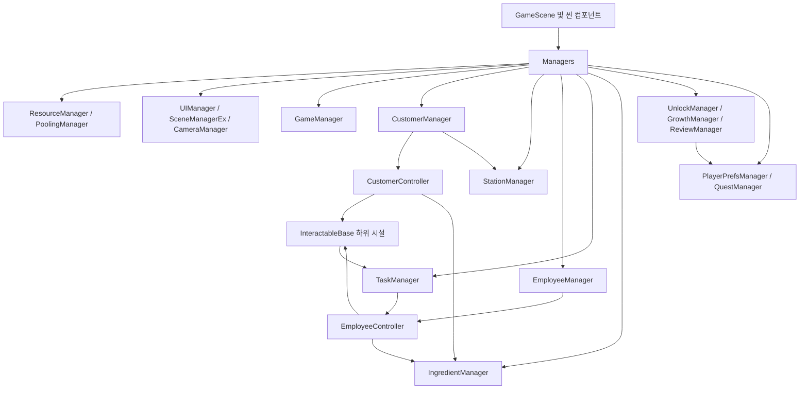
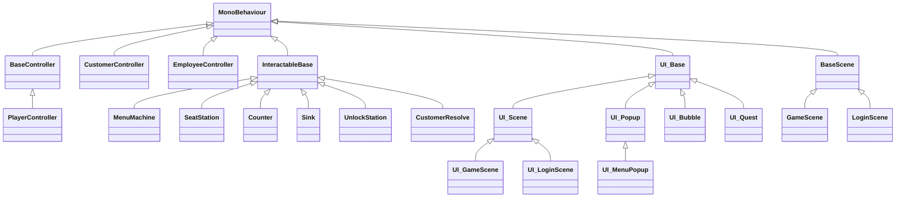
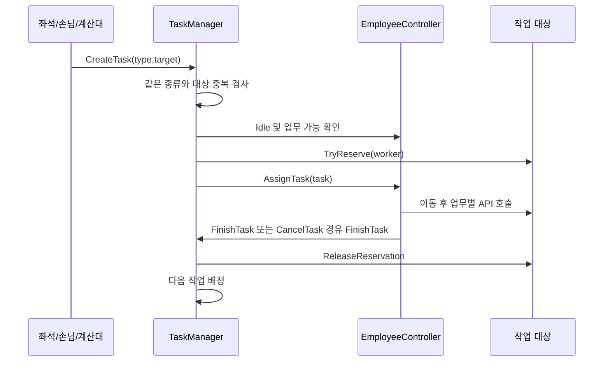
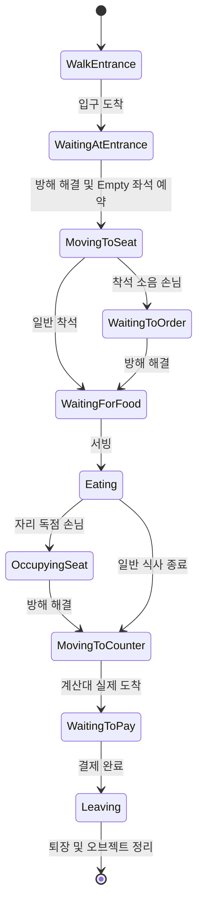

# 현재 아키텍처

기록일: 2026-10-26. [DEVELOPMENT_STATUS](DEVELOPMENT_STATUS.md)의 코드 기준 스냅샷을 설명한다. 의도한 미래 구조는 [GAME_DESIGN](GAME_DESIGN.md)과 구분한다.

## 폴더와 실행 환경

| 위치 | 책임 |
| --- | --- |
| `Assets/01_Scripts/Managers/Core` | 공용 인프라, 초기화, 리소스·풀·씬·UI·저장·퀘스트. 수정 전 사용자 승인 필수 |
| `Assets/01_Scripts/Managers/Content` | 손님·직원·작업·좌석·해금·성장·리뷰·식기·영업 상태 |
| `Assets/01_Scripts/Managers/UGS` | 서비스 관련 과거 코드. 대부분 전체 주석 처리되어 현행 기능으로 사용하지 않음 |
| `Assets/01_Scripts/Content` | 씬 오브젝트의 입력, 이동, 상태, 상호작용, 가구 배치 |
| `Assets/01_Scripts/Data`, `Utils/Quest` | ScriptableObject 설정 및 퀘스트 실행 자료 |
| `Assets/01_Scripts/UI` | UI_Base, UI_Scene, UI_Popup 및 화면·서브 UI |
| `Assets/01_Scripts/Utils` | Define enum, 이동 입력/컨트롤러, Poolable 등 |
| `Assets/02_Scenes`, `03_Prefabs`, `10_Data` | 프로젝트 씬, 게임 프리팹, 레시피·해금·퀘스트 에셋 |
| `Assets/Resources` | FurnitureCatalog, CameraRig 등 아직 Resources 경로를 사용하는 자산 |
| `Assets/AddressableAssetsData` | 사전 로딩 그룹·주소·Preload 라벨 설정 |
| `Assets/09_Plan` | 보존하는 과거 기획 문서. 현재 구현 상태의 기준은 아님 |

Unity 6000.5.10f1, URP 17.5.0, Input System 1.20.0, AI Navigation 2.0.14, Cinemachine 3.1.7, uGUI 2.5.0을 사용한다. Addressables는 직접 manifest 항목이 아니라 lock 파일에 해결된 의존성 2.9.1이다. DOTween도 코드에서 사용한다. 게임 스크립트 전용 asmdef는 확인되지 않으며 주요 타입은 Assembly-CSharp에 있다. 정확한 의존성은 [manifest](../Packages/manifest.json)와 [lock](../Packages/packages-lock.json)을 따른다.

## 매니저와 씬의 생명주기

`Managers`는 MonoBehaviour 싱글턴이며 나머지 주요 매니저를 일반 C# 객체로 생성하는 전역 접근점이다. 명시적 생성자 의존성 주입보다 `Managers.Customer`, `Managers.Task` 같은 정적 접근을 사용한다.

1. 첫 `Managers.Instance` 접근 때 `@Managers`를 찾거나 생성하고, 플레이 중이면 DontDestroyOnLoad로 유지한다. 매니저 필드는 `new`로 다시 구성된다.
2. Core 일부를 초기화하고 `Resource.Init()`가 Preload 비동기 로드를 시작한다. Customer/Employee는 로드 완료 이벤트를 기다릴 수 있다. Quest는 직렬화된 카탈로그를 읽고, Ingredient는 `IngredientData` 라벨의 재료 데이터 로드를 시작한다. Growth는 Addressables 주소 `GrowthCatalog`의 카탈로그 로드를 시작하며 완료 후 저장 단계와 플레이어 효과를 적용하고 `OnChanged`를 보낸다. Review는 저장 통계를 읽는다. 재료 로드가 끝나기 전 손님이 착석해도 주문은 먼저 확정하고 재료 예약만 보충 알림까지 기다린다.
3. `Managers.Awake()`는 `Game.OnAwake()`를 호출한다. 이 함수는 이름이 `Player`인 활성 오브젝트를 찾는다. 플레이어 없는 씬의 예외 방어가 없다.
4. `CustomerSceneBinder.Awake()`는 스폰·입구 대기점·퇴장점을 등록한다. `PlayerController.Awake()`는 자신의 Instance, 적재 시스템, 저장 잔액, 성장, 카메라 타깃을 연결한다.
5. `GameScene`은 리소스 로드 후 `Unlock.Init()` → `Customer.RefreshAvailableRecipes()` → 선택적 `Game.OpenShop()` → 게임 UI 생성 순서로 진행한다.
6. `Managers.Update()`가 CustomerManager만 매 프레임 갱신한다. 손님·직원·시설은 각 MonoBehaviour에서 자체 갱신한다.
7. `SceneManagerEx.LoadScene()`은 `Managers.Clear()` 후 enum 이름으로 씬을 비동기 로드한다. Clear가 처리하는 것은 씬·사운드·UI·직원 목록·작업 목록이다. 손님 대기열, 영업 상태, 식기 등 모든 세션 상태를 일괄 초기화하는 구현은 아니다.

`BaseScene.SceneType`은 기본 Unknown이며 파생 씬에서 지정하는 코드가 없다. LoginScene의 Init은 비어 있다. Level1_Pocha는 GameScene 컴포넌트를 사용하지만 Define.Scene과 기본 빌드 목록에는 없다. 생명주기 변경 전에는 직접 레벨 실행과 로그인 경유 실행을 별도로 검증해야 한다.

근거: [Managers](../Assets/01_Scripts/Managers/Core/Managers.cs), [SceneManagerEx](../Assets/01_Scripts/Managers/Core/SceneManagerEx.cs), [GameScene](../Assets/01_Scripts/Scene/GameScene.cs), [GameManager](../Assets/01_Scripts/Managers/Content/GameManager.cs).

## 상속과 인터페이스

`IDamageable`, `IStatusTarget`은 선언만 있고 주요 게임 코드에서 구현/사용이 확인되지 않았다. 이를 근거로 전투·상태이상 시스템을 구현 완료로 기록하면 안 된다. `BaseController`도 현재 공통 게임 행동이 없는 골격이다.

## 시스템별 책임과 핵심 API

| 시스템 | 소유하는 상태/책임 | 설계에 필요한 API와 계약 |
| --- | --- | --- |
| [PlayerController](../Assets/01_Scripts/Content/Player/PlayerController.cs) | 잔액, 현재 플레이어, 성장 효과·화면 드래그·운반 애니메이션 연결 | `TrySpendMoney(amount)`는 양수·잔액 충족 시 차감. `ApplyGrowth`가 이동 코드의 범용 `MoveSpeed`, 적재량, 작업 시간에 누적 효과를 적용. `UpdateMoney`, `SetMoney`는 저장값·이벤트를 갱신. 공개 money 직접 수정은 이 경로를 우회 |
| [ThirdPersonController](../Assets/01_Scripts/Utils/ThirdPersonController.cs) | CharacterController 이동·Input System 입력·클릭 이동 | `MoveSpeed`에 최종 이동 속도를 설정한다. `ExtraMoveDirection`으로 외부 입력 방향을 선택적으로 받고, `MovementDisabled`로 입력 상태 정리를 알린다. 제어 모드 enum은 클래스 내부에 있으며 성장·적재·프로젝트 Define 타입은 참조하지 않는다 |
| [StackingSystem](../Assets/01_Scripts/Content/Player/StackingSystem.cs) | 적재 목록·용량·이동 연출 | `CheckListItem`, `CanHoldMenu(recipe)`로 사전 검사 후 `PickUpItem`. `PopItem()`은 맨 위 물건을 제거·반환/파괴. `GetFirstListItemType`은 이름과 달리 맨 위 종류를 읽음 |
| [CustomerManager](../Assets/01_Scripts/Managers/Content/CustomerManager.cs) | 입구 대기열, 생성 타이머, 주문 가능한 레시피 | `SetScenePositions`, `RefreshAvailableRecipes`, `TryGetRandomRecipe`, `OnUpdate`. 씬 참조 준비와 리소스 로딩 필요 |
| [CustomerController](../Assets/01_Scripts/Content/Controller/CustomerController.cs) | 손님 한 명의 이동·주문·식사·방해·결제 상태 | `Init`, `AssignSeat`, `OnFoodServed(FoodRecipeData)`, `BasePay`, `ResolveDisturbance`, `CompletePayment`. 주문과 실제 서빙 레시피를 비교하고 주문 가격에 오메뉴 절반 규칙을 적용 |
| [StationManager](../Assets/01_Scripts/Managers/Content/StationManager.cs) | 좌석 등록부, 빈 좌석 탐색 | `RegisterSeat`, `UnregisterSeat`, `FindAvailableSeat`, `RegisterDirtyTable`. AvailableSeatCount는 빈 좌석 수가 아닌 활성 좌석 수 |
| [EmployeeManager](../Assets/01_Scripts/Managers/Content/EmployeeManager.cs) | 직원 후보 로드·선택 고용·목록 | `EmployeeData` 라벨에서 후보를 읽어 ID 중복을 거르고 순서대로 제공. `CanHire`, `TryHire`가 후보별 비용·중복을 확인하고 공용 프리팹을 생성해 작업 재배정. `HireEmployee(Vector3?)`는 비용 없는 기존 생성 API. `OnChanged`는 UI 갱신용. `Clear`는 목록과 이번 실행의 고용 ID를 비움 |
| [TaskManager](../Assets/01_Scripts/Managers/Content/TaskManager.cs) | 작업 목록, 중복 방지, 배정·예약 해제 | `CreateTask(type,target)`, `AssignWaitingTasks`, `FinishTask`, `TakeOverTask` 두 오버로드, `RemoveTasksFor`, `RegisterDishWashTask` |
| [EmployeeData](../Assets/01_Scripts/Data/EmployeeData.cs) / [고용 UI](../Assets/01_Scripts/UI/Popup/UI_MenuPopup.cs) | 후보 설정 / 표시와 입력 | `Assets/10_Data/Employee`의 세 에셋이 같은 프리팹을 참조한다. UI는 프리팹에 미리 만든 세 카드의 정보·버튼을 Bind하고 후보 로드, 고용, 잔액 변경 이벤트마다 갱신한다. 카드 수는 현재 3개로 고정 |
| [EmployeeController](../Assets/01_Scripts/Content/Controller/EmployeeController.cs) | 직원의 NavMesh 이동·실제 작업·개별 성장 | `ApplyHireData`가 기본 속도와 허용 업무를 후보 데이터로 교체한다. `AssignTask`, `CancelTask`, `StopTaskForPlayer`, `SetMoveUpgrade`, `SetInteractionUpgrade`. 작업 시간 성장은 후보별 기본 배율에서 감소량을 뺀다. 게임 틱은 자체 Update |
| [IngredientManager](../Assets/01_Scripts/Managers/Content/IngredientManager.cs) | 매장 공용 재고, 주문 예약, 원자적 차감, 보충 API | `HasIngredients`, `TryReserveForOrder`, `HasReservation`, `TryUseReservedIngredients`, `TryUseIngredients`, `ReleaseReservation`, `AddIngredients`, `GetIngredientData`. 시작 수량·이름·가격은 `10_Data/FoodIngredient`의 재료 데이터에서 비동기로 읽고, 수량만 런타임 메모리에 보관 |
| [MenuMachine](../Assets/01_Scripts/Content/InteractObject/MenuMachine.cs) | 레시피 검증·기계 작업자·생산 | `Recipe`, `CanOfferRecipe`, `TryStartMachineWorkForEmployee`, `TryProduceMenu`. 주문 예약 또는 미예약 수량을 IngredientManager에서 확인. 공통 예약과 기계 점유가 함께 있음 |
| [SeatStation](../Assets/01_Scripts/Content/InteractObject/SeatStation.cs) | 좌석 상태·손님 참조·서빙·청소 | `SetState`, `IsWaitingToServe`, `ServeForEmployee`, `CleanSeat`, `CleanSeatForEmployee`. OnEnable/OnDisable에서 등록/해제 |
| [Counter](../Assets/01_Scripts/Content/InteractObject/Counter.cs) | 결제 대기열·돈 오브젝트 배치 | `AddWaitingCustomer`, `CollectForEmployee`, `PayPoint`. OnEnable에서 단일 `Managers.Game.Counter`로 등록 |
| [UnlockManager](../Assets/01_Scripts/Managers/Content/UnlockManager.cs) | 데이터별 발판·해금 상태·생성물 | `Init`, `RefreshMapState`, `UnlockNode(UnlockNodeData)`. 에셋 하나가 해금 지점 하나이며 선행 조건도 에셋 참조로 비교한다. 씬 변경 시 메모리 상태를 비우며 영속 저장은 없다 |
| [GrowthManager](../Assets/01_Scripts/Managers/Content/GrowthManager.cs) | 전역 성장 단계·카탈로그·구매 | `TryUpgrade`, `TryUpgradeEmployeeStat`, `GetLevel`, `GetNextPrice`, `GetTotalValue`, `ApplyStartingEmployeeStats`. 직원별 구매는 별도 저장하지 않음 |
| [ReviewManager](../Assets/01_Scripts/Managers/Content/ReviewManager.cs) | 누적 리뷰 수·별점 합계·결제 배율 | `CreateReview`가 통계 저장과 결제 결과 생성까지 수행. 단순 조회 함수가 아님 |
| [FurniturePlacementController](../Assets/01_Scripts/Content/Furniture/FurniturePlacementController.cs) | 구매 재고·입력·검사·미리보기·UI 생성·배치 저장 | `BuyFurniture`, `GetInventoryCount`, `BeginPlacement`, `CancelPlacement`. BeginPlacement의 ID 인수는 현재 즉시 선택에 사용하지 않고 보유 목록을 엶 |

매니저는 목록/전역 규칙을, 컨트롤러는 개별 오브젝트의 실제 동작을 주로 맡는다. 다만 가구 컨트롤러는 UI·구매·저장까지 맡고, CustomerController는 리뷰 입력과 연출까지 가진다. 책임 분리가 완전한 구조로 간주하지 않는다. 한 시스템을 여러 Manager로 무조건 분할하지 말라는 기존 규칙도 유지한다.

창고와 배송: `IngredientManager`가 용량·배송·반환을 관리하고 `Storage`와 `DeliveryZone`이 씬 범위를 제공한다. 활성 창고가 있을 때 기본 용량은 15이며 창고별 추가 용량 기본값은 0이다. 배송 지점은 최대 12개만 표시하고 나머지 물건은 비활성 상태로 대기하며 빈자리에 순서대로 표시한다. 표시된 물건의 위치는 유지해 직원 예약 대상을 움직이지 않는다. `CarryIngredient` 직원 업무는 배송 물건 예약 후 창고 이동과 입고를 수행하고, 만재 시 배송 지점에 반환한다. 재료 에셋은 임시 상자 프리팹을 직접 참조한다.

## 상호작용과 작업 흐름

플레이어는 `PlayerController`에 현재 상호작용 대상 하나를 보관한다. `InteractableBase`는 직원 작업 인계 전에 대상을 선점하고 완료·취소·비활성화 때 대상 예약과 플레이어 등록을 해제한다. 다른 대상은 범위에 남아 있으면 이후 다시 시작을 시도한다. `Sink`의 별도 잔 자동 회수도 작업 중이면 대기한다. 직원 예약 방식은 유지한다. 겹친 트리거와 직원 인계의 실제 플레이 검증은 남아 있다.

`TrashCan`은 플레이어 스택의 맨 위 `ItemType.Menu`만 처리한다. `StackingSystem.TakeTopItem`은 획득 이동을 중지하고 아이템을 파괴하지 않은 채 분리하며, 휴지통이 도착 또는 연출 중단 시 기존 리소스 관리 경로로 정리한다. 간격은 플레이어 성장 배율과 무관하게 기본 0.2초다. 직원 사용과 재료 반환은 없다. 주문 재료로 만들어진 메뉴 폐기 후 직원 작업 복구는 별도 검토가 필요하다.

휴지통 프리팹의 `TrashArea`는 트리거의 가로·세로 크기에 맞춰 사전 배치한 바닥 시각 표시다. 표시에는 콜라이더가 없으며 트리거 변경에 자동으로 따라가지 않으므로 크기와 위치를 함께 조정해야 한다.

`InteractableBase`는 Player 레이어의 플레이어 또는 EmployeeController를 식별한다. 대상의 `CanInteract`가 허용하면 예약 → 시작 → 진행 → 완료를 수행하고 범위 이탈·조건 변경·비활성화 시 정리한다. 플레이어 작업 시간은 `Duration × InteractionTimeScale`이다. 직원 자동 작업은 이 트리거 시간 루프에 전적으로 의존하지 않고 EmployeeController가 대상의 별도 작업 API를 호출한다.

플레이어가 가능한 작업에 접근하면 `TakeOverTask`가 직원 작업을 대기로 돌린다. 기계에는 별도의 제조 예약도 있으므로 취소·종료 시 두 예약을 모두 해제해야 한다. 작업 목록 변경 중 재배정 호출이 발생할 수 있다. 대상 비활성화·직원 취소·플레이어 개입을 각각 검증하지 않고 새 업무를 추가하지 않는다.

설거지는 `DishManager.DirtyDishCount > 0`뿐 아니라 직원이 실제 더러운 잔을 들고 있어야 배정된다. 현재 `SeatStation.CleanSeatInternal`의 잔 생성/공용 재고 추가가 블록 주석 안에 있어 주 루프에서 이 조건을 만들지 않는다.

## 주요 상태 전이

- 입구 소음 손님은 WaitingAtEntrance에 남고 `CanLeaveQueue`가 false다.
- 좌석: Empty → Reserved → Occupied → Dirty → Empty. 좌석 해제는 계산대 이동 시작과 연결된다.
- 직원: Idle → MovingToWork → Working → Idle. 서빙 내부 enum `ServingStep`은 None/MakeBeer/DeliverBeer이다.
- 실패 복구는 상태별로 다르다. 계산대 이동은 경로 재시도가 있지만 입구/좌석/퇴장 이동에는 같은 수준의 제한시간 처리가 없다.

## 이벤트와 데이터 전달

| 발행자/이벤트 | 내용 | 현재 소비 경로 |
| --- | --- | --- |
| ResourceManager.assetLoaded | Preload 처리가 끝남 | GameScene, CustomerManager, EmployeeManager. 콜백 호출 뒤 IsLoaded=true로 설정하는 현재 순서에 주의 |
| PlayerController.OnMoneyChanged | 새 잔액 int | UI_GameScene 구독 및 Clear 해제 |
| QuestManager.OnQuestChanged | 제목·설명·진행·목표·완료 | UI_Quest.Init/OnEnable에서 구독하고 비활성화·파괴 시 해제 |
| QuestManager.OnQuestCompleted | 실제 지급한 보상 금액 | UI_Quest가 진행바·완료·보상 문구를 순서대로 표시한 뒤 AdvanceAfterPresentation 호출 |
| StationManager.OnSeatCountChanged | 활성 좌석 수 | 주요 게임 코드의 구독처 미확인 |
| GrowthManager.OnChanged | 카탈로그 로드 완료 또는 성장 구매 후 변경 알림 | UI_MenuPopup이 플레이어 성장 카드 갱신에 구독하고 Clear에서 해제 |
| ReviewManager.OnReviewChanged | 평균 별점과 리뷰 수 | 주요 게임 코드의 구독처 미확인 |
| DishManager.OnDishCountChanged | 더러운/깨끗한 식기 수 | 주요 게임 코드의 구독처 미확인 |
| FurniturePlacementController.OnInventoryChanged | 가구 재고 변경 | 외부 UI 구독처 미확인 |

중앙 EventManager의 이벤트 버스 구현은 주석 처리되어 있다. 실제 전달은 직접 메서드 호출과 각 객체의 C# event를 사용한다. 이벤트 이름이 존재한다고 화면까지 연결됐다고 판단하지 않는다.

손님은 활성 기계의 레시피 중 하나를 재고와 무관하게 주문하고 말풍선에 표시한다. 이후 `FoodRecipeData.Ingredients`를 IngredientManager에 예약한다. 재료가 모자라면 주문·좌석을 유지하고 직원 서빙 작업은 만들지 않는다. `IngredientData` 라벨의 재료 정의를 읽은 직후, `AddIngredients` 보충, 기존 주문의 예약 해제 때 변경 이벤트를 보내 같은 주문의 예약을 다시 시도한다. 예약 성공 후 서빙 작업을 만든다. 예약 수량은 다른 주문과 플레이어 제조가 사용하지 못하며 제조에 성공할 때 실제 재고에서 차감한다. 직원 제조는 해당 손님의 레시피를 선택하고, 플레이어 제조는 같은 레시피 주문 예약을 우선 처리하며 없으면 미예약 재고를 사용한다. `UI_MenuPopup`은 재료 데이터와 재고를 표시하고 구매 시 `PlayerController.TrySpendMoney`와 `IngredientManager.Deliver`를 호출하며 배송 실패 시 환불한다. 입고할 때만 `AddIngredients`로 공용 재고가 증가한다. 현재 가격 0은 무료 테스트 구매로 처리한다. 가격 밸런스와 재고 저장은 없다. 서빙은 `ItemController.MenuRecipe → SeatStation → CustomerController.OnFoodServed(FoodRecipeData)`로 실제 레시피를 전달한다. `Counter`는 손님의 `BasePay`를 리뷰 계산에 전달한다. 퀘스트 보고는 여전히 `ItemType.Menu`만 전달하므로 레시피별 퀘스트는 DEV-006에서 처리해야 한다.

재화 흐름은 `Counter → ReviewManager.CreateReview → 돈 ItemController.Value → StackingSystem 획득 연출 → PlayerController.UpdateMoney → PlayerPrefs/OnMoneyChanged`다. 시설 해금은 `UnlockStation 분할 지불 → UnlockManager.UnlockNode → 생성/활성화 → 주문 후보 갱신`이며 완료 시 퀘스트에도 보고한다.

## 데이터와 저장 계약

| 데이터 | 키/식별 방식 | 현재 보장과 제한 |
| --- | --- | --- |
| 플레이어 재화 | `ProjectB.Player.Money` | SetInt는 메모리 값 갱신. 플레이어 Pause/Quit에서 Save 호출 |
| 매장 재료 | `Assets/10_Data/FoodIngredient` 재료 에셋의 `StartingAmount` | IngredientManager 메모리에서 관리. 재시작하면 데이터의 시작 수량으로 초기화 |
| 전역 성장 | `ProjectB.Growth.Save` | JSON version 3, 버전 1~3 읽기. 과거 employee_clean/make를 employee_interact로 옮기고 큰 단계 유지 |
| 리뷰 | `ProjectB.Review.Count`, `ProjectB.Review.StarTotal` | 리뷰 처리마다 명시적 Save |
| 가구 재고 | `ProjectB.Furniture.Inventory` | 공통 JSON, 현재 버전 필드 없음 |
| 가구 배치 | GameScene: `ProjectB.Furniture.Save`; 다른 씬: `ProjectB.Furniture.Save.{sceneName}` | version 1. ID·위치·Quaternion·씬 기존 가구 여부·형제 순번 경로 저장 |
| 해금 및 분할 지불 | UnlockNodeData 참조 집합 / UnlockStation 내부 필드 | 메모리에만 유지. 영속 키 없음 |
| 고용 목록·직원별 성장·퀘스트 진행·식기 재고·진행 중 손님/작업 | 런타임 객체 | 해당 시스템의 저장/복원 구현 없음 |

[PlayerPrefsManager](../Assets/01_Scripts/Managers/Core/PlayerPrefsManager.cs)의 SetInt/Float/String은 디스크 Save를 직접 호출하지 않는다. SetJson은 Save를 호출한다. 주석보다 구현을 기준으로 판단한다. 여러 시스템 값을 함께 쓰는 원자적 저장·통합 세이브 버전·클라우드 동기화는 없다.

`FoodRecipeData`, `UnlockNodeData`, `GrowthCatalog`, `FurnitureCatalog`, `QuestData/QuestCatalog`는 설정 에셋이다. 런타임 보유 단계나 퀘스트 진행은 별도 객체에 보관한다. 새 ID와 enum 숫자를 변경할 때는 저장 데이터 및 Unity 직렬화 호환성을 먼저 검토해야 한다.

## UI와 리소스

- UI_Base는 enum 이름에 해당하는 자식을 찾아 타입별 배열에 Bind한다. 프리팹 이름과 enum 이름이 계약이다. UI 요소 enum은 해당 UI 스크립트에 둔다. UI_GameScene은 잔액과 메뉴 버튼을 연결한다. UI_MenuPopup은 자체 GameObjects/Buttons/Texts enum으로 사전 제작된 메인·시장·고용·플레이어 성장 패널을 Bind한다. 성장 카드는 `GrowthManager.GetItem/GetLevel/GetNextPrice/GetTotalValue`를 읽고, 버튼은 `TryUpgrade`를 호출한다. `OnMoneyChanged`와 `GrowthManager.OnChanged`에서 표시를 갱신하고 Clear에서 구독을 해제한다. 가격 차감·단계 저장·효과 적용은 GrowthManager가 담당한다.
- UIManager는 씬 UI 하나와 팝업 스택을 보관하고 ScreenSpaceCamera Canvas 및 정렬값을 설정한다. 서브 UI는 프리팹을 생성/풀링한다. 프리팹 인스턴스 생성과 프리팹 내부 요소를 코드로 만드는 것은 구분한다.
- UI_Bubble은 주문·진행·상태 표현과 앵커 추적을 맡는다. 처음 표시할 때 UI 풀에서 가져와 소유 오브젝트의 자식으로 붙인 뒤, 숨길 때 풀에 반환하지 않고 비활성화한다. 소유 오브젝트가 다시 활성화되면 같은 말풍선을 켜서 재사용한다. 따라서 풀에서 한 번 가져온 말풍선은 소유 오브젝트가 살아 있는 동안 그 오브젝트가 보관한다. UI_Quest는 자체 Init에서 QuestManager 이벤트를 구독한다. 목표를 달성하면 QuestManager가 완료·보상 지급을 먼저 확정하고 UI 연출 종료 알림을 기다린다. UI가 없거나 연출 도중 사라지면 다음 목표로 즉시 진행한다. 퀘스트 진행·완료 대기 상태는 아직 저장하지 않는다.
- 가구 컨트롤러는 UI를 직접 new GameObject로 구성한다. 현재 UI 프리팹 제작 규칙과 충돌하며 씬/주요 프리팹 연결도 확인되지 않았다.
- ResourceManager는 Preload 캐시에서 동기 Load를 제공한다. 성장 카탈로그는 `10_Data/GrowthCatalog.asset`을 Addressables `GrowthCatalog` 주소로 비동기 로드한다. 다른 기존 Resources 자산은 `LoadResource`를 사용할 수 있다. 로드 실패를 성공과 구분한 복구 절차와 동시 동일 키 로딩 처리가 부족하다.
- Poolable이 있으면 일반 생성/파괴를 풀 Get/Release로 연결한다. 가구는 Unpooled API를 사용한다. 풀 키가 원본/인스턴스 이름이므로 풀링 객체 이름 변경, OnEnable 이전 상태 복구, 반환 시 이벤트·Tween 정리를 확인해야 한다.

근거: [UI_Base](../Assets/01_Scripts/UI/Base/UI_Base.cs), [UIManager](../Assets/01_Scripts/Managers/Core/UIManager.cs), [UI_Bubble](../Assets/01_Scripts/UI/SubItem/UI_Bubble.cs), [ResourceManager](../Assets/01_Scripts/Managers/Core/ResourceManager.cs), [PoolingManager](../Assets/01_Scripts/Managers/Core/PoolingManager.cs).

## 새 기능을 연결할 위치

| 추가/변경 | 연결 지점 | 반드시 함께 확인할 것 |
| --- | --- | --- |
| 메뉴 | FoodRecipeData, ItemController.MenuRecipe, MenuMachine | 기계 종류·결과 프리팹 역참조, 주문 후보 갱신, 직원 선택, 서빙 레시피, 가격, 퀘스트 매핑 |
| 시설 상호작용 | InteractableBase 하위 클래스와 프리팹 | Player 레이어, Trigger, 예약, Duration, 취소·비활성화, BubbleAnchor |
| 직원 업무 | Define.EmployeeTaskType, TaskManager, EmployeeController | 작업 생성 조건, CanWork, 선점/해제, 경로 실패, 플레이어 개입, 완료 후 재배정 |
| 성장 항목 | GrowthCatalog + GrowthManager + 실제 대상 | 단계 저장 호환성, 누적 효과, 최소 시간, 구매 UI. 새 Core 수정 필요 시 승인 |
| 가구 | FurnitureCatalog + FurniturePlacementController + SeatStation 등 | 미리보기 생명주기, 예약 좌석 이동, 바닥/통로, 안정적인 저장 ID, 현재 UI 진입 연결 |
| UI | UI_Base/Scene/Popup + 해당 UI 스크립트의 enum + 프리팹 | Bind 이름, 이벤트 구독/해제, 중복 Init, 사전 로딩 주소 |
| 퀘스트 | QuestData/Catalog + 행동 보고 | Menu/노드/가구 매핑, 저장 정책, UI_Quest의 구독과 완료 연출 종료 알림. QuestManager는 Core 승인 대상 |

구체적인 결함과 미검증 위험은 [DEVELOPMENT_STATUS](DEVELOPMENT_STATUS.md), 처리 순서는 [BACKLOG](BACKLOG.md)에서 관리한다. 여기서 새 구조로 변경하기로 결정한 것은 아니다.
