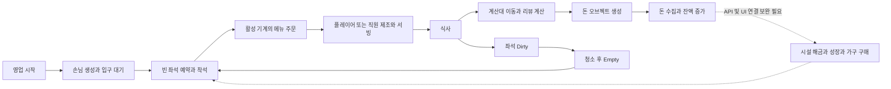

# 게임 기획

기록일: 2026-10-26 (Asia/Seoul). 코드 기준과 검증 범위는 [DEVELOPMENT_STATUS](DEVELOPMENT_STATUS.md)를 따른다.

## 문서의 사실 구분

- **사용자 확정**: 이번 요청에서 Unity 6 기반 3D 아케이드 술집 타이쿤이라는 장르와 AI 협업 역할을 지정했다.
- **기존 문서의 설계**: 과거 기획 문서에 명시되어 있다. 원래 승인 일자와 현재 유지 여부를 알 수 없는 세부 사항은 별도 표시한다.
- **코드 관찰**: 현재 코드·직렬화 데이터에서 확인되는 동작이다. 최종 기획 의도나 실제 플레이 검증을 뜻하지 않는다.
- **확인 필요/검토 제안**: 설계자가 결정해야 하거나 코드 연결·동작 확인이 남았다. 구현 지시로 취급하지 않는다.

## 콘셉트와 핵심 순환

플레이어가 술집 안을 이동하며 제조·서빙·청소·계산·방해 손님 해결을 수행하고, 수익으로 매장을 확장하는 구조가 코드에 존재한다. 직원과 성장은 자동화 확장을 위한 기반 API가 있으나, 현재 UI 진입점과 직원 서빙에 공백이 있어 전체 자동화 루프를 완성으로 기록하지 않는다.

도식은 연결하려는 게임 흐름이다. 각 단계의 현재 실행 가능성은 개발 상태 표를 확인한다. 청소 이후 식기 회수·설거지·재료 공급은 현재 주 루프에 연결되지 않는다.

## 플레이어 행동

| 행동 | 코드에서 확인한 규칙 | 제한/확인 필요 |
| --- | --- | --- |
| 이동 | `ThirdPersonController`의 CharacterController 이동. `ScreenMoveInput`의 화면 드래그, Input System 액션, 모드별 클릭 이동 | 클릭 이동은 목적지 방향으로 직접 이동하며 NavMesh 경로 탐색이 아니다. 실제 조작 모드는 프리팹/씬 값을 확인해야 한다 |
| 물건 운반 | 최대 적재량 검사. 메뉴는 같은 `FoodRecipeData`끼리만 적재. 돈은 NoStack으로 용량과 무관하게 획득 | `PickUpItem` 자체는 용량을 재검사하지 않으므로 호출자가 검사해야 한다 |
| 시설 이용 | 트리거 안에서 조건이 맞으면 작업 시작·시간 경과·완료. 머무르면 반복 가능 | Player 레이어, 콜라이더와 참조 설정에 의존 |
| 제조와 서빙 | 레시피별 기계에서 메뉴 제작, 좌석에서 아이템 소비 후 식사 시작 | 레시피 일치 판정과 직원 제조 선택은 미완성. 현재 임의 아이템까지 통과하는 검사 오류가 있다 |
| 청소 | Dirty 좌석을 Empty로 변경 | 현재 청소는 더러운 잔을 생성하지 않는다 |
| 방해 해결 | 빈손으로 방해 손님 근처에서 작업하면 일반 손님으로 바뀜 | 기본 작업 시간은 코드에서 2.5초. 직원 해결 업무는 없음 |
| 시설 구매 | 해금 발판에 머물며 나누어 지불하고 완료 연출 후 해금 | 지불 중간 상태와 해금 완료 상태의 영속 저장 없음 |

근거: [PlayerController](../Assets/01_Scripts/Content/Player/PlayerController.cs), [StackingSystem](../Assets/01_Scripts/Content/Player/StackingSystem.cs), [이동](../Assets/01_Scripts/Utils/ThirdPersonController.cs), [상호작용](../Assets/01_Scripts/Content/InteractObject/InteractableBase.cs).

## 손님과 좌석 규칙

- 영업 중 `CustomerManager`가 기본 7초마다 생성 시도한다. 입구 대기 인원이 `entranceQueue.Count` 이상이면 추가하지 않는다. 이 한도는 전체 매장 손님 수의 한도가 아니다.
- 입구 맨 앞 손님이 도착했고 이동 가능해야 빈 좌석을 배정한다. 좌석은 Empty → Reserved → Occupied → Dirty → Empty로 순환한다.
- 활성 상태이며 레시피 연결이 유효한 `MenuMachine`들의 중복 없는 레시피 목록에서 균등 무작위 주문을 선택한다. 재고 연결은 없고, 주문 가능 목록은 씬 초기화와 해금 시 갱신된다.
- 식사 시간의 코드 기본값은 5초다. 실제 씬/프리팹이 덮어쓸 수 있으므로 최종 밸런스로 확정하지 않는다.
- 계산대 이동을 시작할 수 있게 된 시점에 좌석을 비우고 청소 작업을 만든다. 계산대 경로가 없으면 재시도하며 대기한다.
- 방해 손님은 생성 시 10% 확률이며 세 유형 중 무작위로 선택된다. 대기줄 소음은 앞줄 이동을 막고, 착석 소음은 주문을 늦추며, 자리 독점은 식사 후 퇴장을 막는다.
- 소음 기본값은 반경 4, 주기 3초다. 주변 일반 손님의 입구 이동·대기·좌석 이동·음식 대기·식사 상태에 방해 횟수를 더한다. 실제 식사 시간을 멈추는 구현은 아니다.
- 메뉴가 전혀 없을 때 주문을 나중에 재시도하는 완결된 흐름은 확인되지 않았다. 주문 실패 후 복구 정책은 확인 필요다.

근거: [CustomerManager](../Assets/01_Scripts/Managers/Content/CustomerManager.cs), [CustomerController](../Assets/01_Scripts/Content/Controller/CustomerController.cs), [SeatStation](../Assets/01_Scripts/Content/InteractObject/SeatStation.cs), [CustomerResolve](../Assets/01_Scripts/Content/InteractObject/CustomerResolve.cs).

## 직원과 자동화

- `HireEmployee`는 직원 생성·초기화·목록 등록·작업 재배정을 수행한다. `HireCost = 1000` 필드는 있지만 함수 안에서 비용을 차감하지 않는다. 유료 고용 규칙이 완성됐다고 보지 않는다.
- 직원 초기화는 청소, 서빙, 계산(`Casher`), 설거지 업무를 모두 추가한다. 직종을 나누는 확정 규칙은 없다.
- 작업은 생성 순서로 검사하고, 가능한 Idle 직원을 목록 순서로 고른다. 거리 최적화·업무별 우선순위 정책은 없다.
- 대상 예약으로 중복 작업을 막고, 작업 가능한 플레이어가 접근하면 직원 업무를 넘겨받는 경로가 있다.
- 직원 상태는 Idle → MovingToWork → Working → Idle이다. 서빙은 제조와 전달 단계로 나뉘지만 현재 검사 오류 때문에 빈손도 전달 단계로 진입한다.
- 직원별 이동·작업 속도 구매 API는 있다. 직원의 고용 목록과 개별 업그레이드는 저장되지 않는다.

자동화 확대 순서는 확정되지 않았다. 먼저 현재 서빙·작업 취소·UI 연결을 검증하는 것을 [BACKLOG](BACKLOG.md)의 개선 제안으로 관리한다.

## 시설과 메뉴

| 시설/데이터 | 현재 역할 | 기획상 확인할 사항 |
| --- | --- | --- |
| MenuMachine + FoodRecipeData | 기계 종류, 재료 목록, 결과 프리팹, 제조 시간으로 메뉴 생성 | 재료 공급처가 연결되지 않으면 무제한 제조. 재료 경제 도입 여부/시점 |
| Counter | 결제 대기열에서 한 명 처리, 리뷰를 계산하고 돈 오브젝트 생성 | 전역 카운터 참조가 하나. 다중 계산대 정책 |
| SeatStation | 손님 자리, 서빙, 청소 상태 | 잘못된 음식의 허용 여부와 결과 |
| Sink + DishManager | 더러운 잔을 깨끗한 잔으로 바꾸고 진열·회수 | 청소의 잔 생성이 중단되어 기존 식기 순환이 끊겨 있음 |
| UnlockStation + UnlockNodeData | 선행 해금, 가격, 생성 프리팹 또는 기존 오브젝트 활성화 | 해금/분할 지불 저장, 매장별 ID 범위 |
| FurnitureCatalog | 현재 `chair` 한 항목, 가격 300 | 가구 종류 확대와 구매 진입 UI |

레시피 에셋은 맥주·우동·`Recipe_ Kimbap` 세 개가 있다. 맥주와 우동은 코드상 기계 종류가 있고 두 레시피의 제조 시간은 1.5초다. `Recipe_ Kimbap`은 파일명과 내용(음식명 우동, 맥주 기계 종류, 우동 프리팹)이 맞지 않아 완성된 김밥 콘텐츠로 계산하지 않는다. 현재 레시피 `Pay` 값은 맥주 0, 우동 20이며 결제 코드에 사용되지 않는다.

근거: [메뉴 기계](../Assets/01_Scripts/Content/InteractObject/MenuMachine.cs), [레시피 정의](../Assets/01_Scripts/Data/FoodRecipeData.cs), [레시피 에셋](../Assets/10_Data/FoodRecipes), [가구 카탈로그](../Assets/Resources/FurnitureCatalog.asset).

## 재화와 성장

플레이어 잔액은 정수 `money`다. 돈을 수집한 애니메이션 완료 시 잔액을 더한다. 결제 완료가 바로 잔액 증가를 뜻하지 않는다. 퀘스트 보상은 잔액에 직접 더한다. 구매는 `TrySpendMoney` 성공 후 다음 단계로 진행하는 방식이 기본이다.

리뷰의 현재 계산 규칙은 다음과 같다. 밸런스 확정 여부는 확인 필요다.

1. 별점 5에서 시작한다. 대기 시간이 5초, 15초, 30초를 각각 초과할 때 1점씩 낮춘다.
2. 방해 횟수마다 1점, 메뉴 불일치에는 2점을 낮추고 1~5점으로 제한한다.
3. 여기서 대기는 **손님 생성부터 음식 제공까지**이며 입구 대기도 포함한다.
4. 이번 리뷰를 누적 평균에 넣은 뒤 `1 + Clamp((평균 - 3) × 0.05, 0, 0.25)`를 기본 결제액에 곱한다. 평균이 최대 5이므로 실제 가능한 최고 보너스는 10%다. 코드 주석의 25%와 다르다.
5. 기본 결제액은 `CustomerController.payAmount`(코드 기본 15)다. 레시피 가격 연결과 정확한 메뉴 불일치 감점은 미완성이다.

현재 성장 카탈로그의 값은 아래와 같다. 가격은 각 단계 구매 비용이고 효과는 누적된다.

| ID | 단계별 비용 | 단계별 효과 | 저장 |
| --- | --- | --- | --- |
| player_speed | 100 / 250 / 500 | 이동 속도 +0.5씩 | 전역 단계 저장 |
| player_stack | 150 / 300 / 600 | 적재량 +2씩 | 전역 단계 저장 |
| player_interact | 150 / 300 / 600 | 작업 시간 배율 -0.08씩 | 전역 단계 저장 |
| employee_speed | 200 / 400 / 800 | 선택 직원 이동 속도 +0.4씩 | 현재 직원 인스턴스만 유지 |
| employee_interact | 200 / 400 / 800 | 선택 직원 작업 시간 배율 -0.08씩 | 현재 직원 인스턴스만 유지 |

시간 배율의 하한은 0.25이며 메뉴 기계는 별도의 최소 제조 시간도 적용한다. 과거 공통 직원 업그레이드 저장은 신규 직원의 시작값으로 읽지만, 현재 구매 API는 직원별이다. 성장 구매 UI 호출은 주요 게임 스크립트와 씬/프리팹 검색에서 확인되지 않았다.

근거: [GrowthManager](../Assets/01_Scripts/Managers/Content/GrowthManager.cs), [GrowthCatalog](../Assets/Resources/GrowthCatalog.asset), [ReviewManager](../Assets/01_Scripts/Managers/Content/ReviewManager.cs).

## 가구 설계와 현재 코드의 차이

[기존 가구 최종 설계](../Assets/09_Plan/가구_배치_최종_설계.md)의 자유 위치·90도 회전·명시적 모바일 확정·사용 중 좌석 이동 금지 의도는 보존한다. 원래 결정 날짜는 확인되지 않았다.

| 항목 | 기존 문서 | 현재 코드 |
| --- | --- | --- |
| 비용 지불 | 설치 확정 시 차감 | 먼저 구매하여 미배치 재고에 추가하고, 설치 때 재고를 1개 소비 |
| 배치 검사 | 허용/금지 구역, 가구 전체 영역, 동선 보호 | 바닥 높이·법선·네 모서리, OverlapBox, 새 의자 간격 검사. 전용 금지 구역과 통로 연결성 검사 없음 |
| 입력/UI | 한 손가락 조작과 별도 확정 버튼 | 해당 처리 코드 존재. UI를 런타임에 생성하며 주요 씬/프리팹에서 컨트롤러 연결은 미확인 |
| 저장 | ID·위치·회전, 버전 유지 | 버전 1. 위치는 씬별, 미배치 재고는 공통. 씬 기존 가구는 형제 순번 경로로 식별 |
| 미리보기 | 기능 시스템 등록에 참여하지 않음 | 활성 복제 후 컴포넌트를 끄므로 OnEnable이 먼저 실행될 위험 |

위 차이의 승인 배경은 확인 필요다. 기존 문서를 현재 코드에 맞춰 조용히 재작성하지 않는다. [과거 성장 계획](../Assets/09_Plan/UpgradeAndFurniturePlan.md)의 전역 직원 성장, BeerMachine, UnlockAnchor, 구매 API 부재 설명도 현재 구현과 다르므로 과거 설계 자료로만 읽는다.

## 다음 설계에서 답해야 할 질문

- 출시 시작 씬과 실제 플레이 레벨은 무엇인가? LoginScene → GameScene과 Level1_Pocha의 관계를 어떻게 정할 것인가?
- 다른 메뉴 제공은 금지할 것인가, 허용하고 감점할 것인가? 메뉴별 가격은 주문/실제 제공 중 무엇을 기준으로 할 것인가?
- 고용 비용, 직원별 성장 저장, 자동화 UI의 첫 범위는 무엇인가?
- 식기 회수·재료 소비를 다시 주 루프에 넣을 것인가? 공급과 부족 시 손님 처리 규칙은 무엇인가?
- 가구 선구매 재고 방식과 기존 설치 시 결제 설계 중 어느 정책을 유지할 것인가?
- 해금·재화·성장·퀘스트를 재접속 시 어떤 단위로 함께 복구할 것인가?

질문은 미확정 항목이다. 기계 업그레이드, 가구 종류 확대, 통로 보호, 클라우드 저장·광고·결제는 현재 완료 기능으로 간주하지 않는다.
